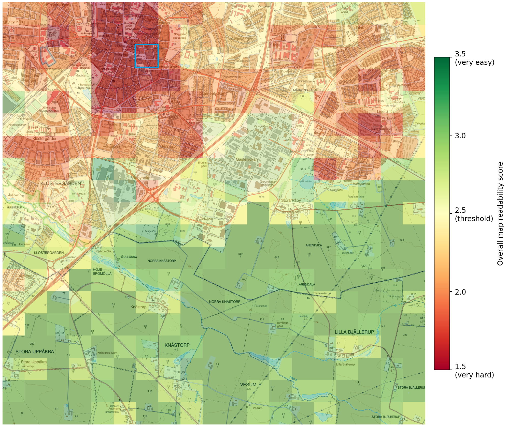

 
 
 

# Map readability

 

Map production is progressing toward full automation. To ensure that automatically generated maps are satisfactory in terms of human readability, methods are required to assess map readability and, for example, initiate appropriate generalization procedures. In this repository we store some foundation model scripts for evaluating map readability. Two approaches are used: (1) direct multimodal large language model approach - using a schema called MRAS to prompting ChatGPT, and (2) multimodal feature fusion approach using the perception encoder (PE-Core-bigG-14-448) and the multimodal large language model Qwen3.5-27B. More background and example of use of the scripts will be given when they are published.  

Contributors to the scripts and the study:  
Lars Harrie, Karolina Pantazatou, Ali Mansourian - Lund University, Sweden  
Weiming Huang - University of Leeds, UK  
Wenhao Yu, Xiaochi Ma, Yifan Zhang - China University of Geosciences, China  

 
 

## Example output
An example output from the foundation models using approach 1. 

 

 
Source original map:. GSD-Fastighetskartan, raster, Lantmäteriet, Sweden.  © Lantmäteriet  
 

## Contents
The repository includes the following folders:

- Multimodal feature fusion part 1 and part 2 Lund: Scripts for some Swedish maps using approach 2. 
- Multimodal feature fusion part 2 Loas Angeles: Scripts for an automatically generated map over Los Angeles using approach 2. 
- MRAS part 1 - instructions: Scripts for some Swedish maps using approach 1.
- MRAS part 2 - Lund - instructions: Scripts for some Swedish maps using approach 1.
- MRAS part 2 - LA - instructions: Scripts for an automatically generated map over Los Angeles using approach 1. 

 
 

## License
BSD 3-Clause License

Copyright (c) 2026, Lars Harrie and Weiming Huang

Redistribution and use in source and binary forms, with or without
modification, are permitted provided that the following conditions are met:

1. Redistributions of source code must retain the above copyright notice, this
   list of conditions and the following disclaimer.

2. Redistributions in binary form must reproduce the above copyright notice,
   this list of conditions and the following disclaimer in the documentation
   and/or other materials provided with the distribution.

3. Neither the name of the copyright holder nor the names of its
   contributors may be used to endorse or promote products derived from
   this software without specific prior written permission.

THIS SOFTWARE IS PROVIDED BY THE COPYRIGHT HOLDERS AND CONTRIBUTORS "AS IS"
AND ANY EXPRESS OR IMPLIED WARRANTIES, INCLUDING, BUT NOT LIMITED TO, THE
IMPLIED WARRANTIES OF MERCHANTABILITY AND FITNESS FOR A PARTICULAR PURPOSE ARE
DISCLAIMED. IN NO EVENT SHALL THE COPYRIGHT HOLDER OR CONTRIBUTORS BE LIABLE
FOR ANY DIRECT, INDIRECT, INCIDENTAL, SPECIAL, EXEMPLARY, OR CONSEQUENTIAL
DAMAGES (INCLUDING, BUT NOT LIMITED TO, PROCUREMENT OF SUBSTITUTE GOODS OR
SERVICES; LOSS OF USE, DATA, OR PROFITS; OR BUSINESS INTERRUPTION) HOWEVER
CAUSED AND ON ANY THEORY OF LIABILITY, WHETHER IN CONTRACT, STRICT LIABILITY,
OR TORT (INCLUDING NEGLIGENCE OR OTHERWISE) ARISING IN ANY WAY OUT OF THE USE
OF THIS SOFTWARE, EVEN IF ADVISED OF THE POSSIBILITY OF SUCH DAMAGE.
